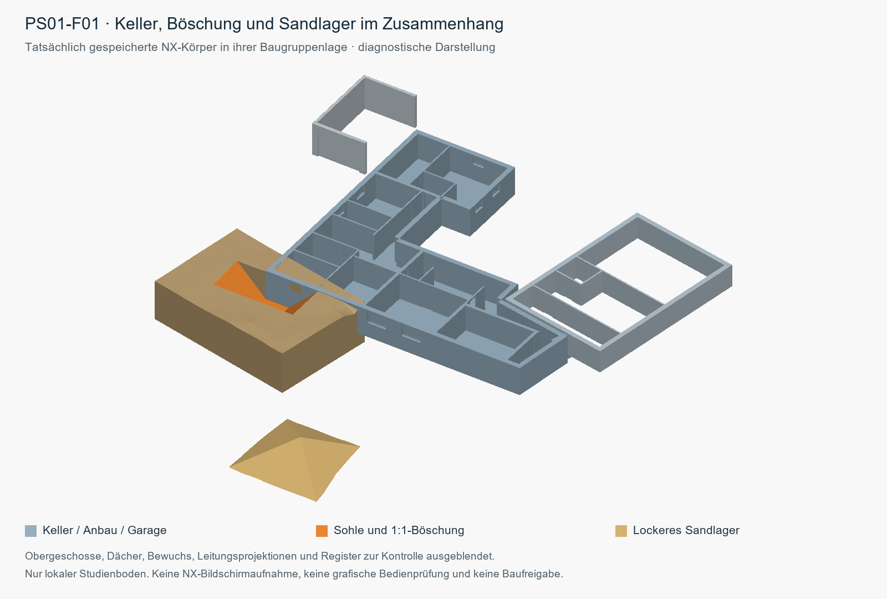

# K02 – nativer Liefer- und Entwicklungsnachweis

01.11.2026, Europe/Berlin. Branch `feature/keller-nx-studie`. K02 erweitert die vorhandene unveränderte G02-Engine außerhalb von `projects/g02/`. Alle Modelle bleiben konzeptionelle Studien ohne Bauausführungsfreigabe.

## Tatsächliche Lieferung und Prüfungen

**Vollständiger nativer Lauf: PASS, Exit 0.** Tatsächlicher Befehl mit vorhandenem Python 3.12.14: `C:/Users/1337/.cache/codex-runtimes/codex-primary-runtime/dependencies/python/python.exe -u tools/nx_project.py build --nx-root C:/Siemens/NX2406 --accept-model-assumptions`. Start 13:26, letzter nativer Feldnachweis 15:08:25 Europe/Berlin. NX 2406.6000; keine Nutzer-GUI oder vorhandenen Modelle gespeichert/geschlossen.

Neue G02-Basis [`20261101T132625_6a1ec1`](../../cad/nx/20261101T132625_6a1ec1/BUILD.json): 29 Parts, 36.023.064 Bytes, Master `PROJEKT_MASTER_G02_PLANBEZUG_313e4df3.prt`, tatsächlicher Build sowie frisches/verschobenes Öffnen bestanden. Der historische Stand `20261031T134924_e0fb72` bleibt bytegleich erhalten. G02-Fingerprint `76e43fb43f93c20e5c980d7a2e694a2027591684534c28c8c9b4f98928e90a9a`.

K02 [`20261101T133310_8b6d68`](../../cad/nx/k02/20261101T133310_8b6d68/BUILD.json): BASE plus alle 22 Kandidaten, **23 unabhängige Zustände/689 Parts**, 1.188.256.427 Speicherbytes. [VERIFY](../../cad/nx/k02/20261101T133310_8b6d68/VERIFY.json) belegt jeden Zustand frisch AsSaved und als vollständig verschobene Kopie mit SearchDirectories. BASE besitzt 29 Parts/28 Komponentenlagen; jedes Feld 30 Parts/29 Lagen. Vollständiges Laden, mm, ausschließlich interne Pfade, keine fremden Interpart-Abhängigkeiten, unveränderte Transformationen und alle Rollen-/Komponentenvolumen tatsächlich bestanden. Alle 29 nativen Baseline-Quellhashes sind vor/nach gleich. Der unveränderte Runner setzte CURRENT erst nach erfolgreichem Gesamtgate fort; `complete_study=true`, `prototype_only=false`, `construction_release=false`.

K02-Fingerprint `f4e0fe0a503bad424e595e65190eac8831f76f712cd7c338cc982f752d783624`. Frischer vollständiger Gesamtplan auf endgültigem Code/neuer Basis, ohne Pilot-Reuse. Native Phase von Quellenprüfrequest bis letztem verschobenem Ergebnis: 5.312,424 Sekunden, strikt seriell. Rohplan/STEP/STL und Arbeitskopien bleiben lokal. Eingaben, Generatorhashes und kompakter finaler Plan sind in BUILD erhalten. Der dort genannte Quellcommit ist Kontext; maßgeblich ist der tatsächliche Fingerprint.

PS01-F06: drei tatsächliche Aushubvolumen 0,00010578150377382823 / 0,007481921010691594 / 4,4970537407080045 m³; Summe 4,504641443222471 m³. Frisches und verschobenes Öffnen erhalten alle drei und konsistente Summen. Über alle 22 Felder beträgt die größte absolute NX−Mathematik-Differenz 2,558 × 10⁻¹³ m³. Das ist ein CAD-Vergleich, keine Geländepräzision: das TIN hat vier Unterteilungen und ein Höhenfehlerband bis 20,78125 mm; feldweise Volumenintervalle sind separat im [Mengenbericht](../../renovierung/planung/2026-11-01/K02_STUDIE.md) und in [K02_MENGEN.json](../../renovierung/planung/2026-11-01/K02_MENGEN.json) ausgewiesen.

Zusätzlicher frischer gespeicherter Registeraudit auf finalem F01: [K02_SAVED_REGISTER.json](K02_SAVED_REGISTER.json), **NX-Prozess Exit 0/PASS**, 72 Registerkurven/72 Feldnoten/72 Statusattribute, 45 gesperrte Felder mit unbekannten Mengen (`JSON null`, nicht 0), eigener Einschränkungshinweis, gespeicherte Freigabe false, Quellterrain geblankt. Vor/nach alle 30 finalen Part-Hashes gleich. Vorhandener real erprobter Leseaudit, kein Save, keine Bildschirmaufnahme oder GUI-Prüfung.

| Abschlussprüfung am 01.11.2026 | Tatsächliches Ergebnis |
|---|---|
| Vollständiger nativer Befehl oben | Exit 0; Log `reports/local/k02/task3/full_build.log`, finale BUILD/VERIFY unter beiden Lieferkennungen |
| `python tools/run_checks.py` | Exit 0; `reports/local/20261101_151013_a772caaf/RESULT.json`: 543 G02-/8 K01-Importdateien bytegleich, Syntax 170 Dateien, 51 Werkzeugtests (1 bestehender Skip), 45 K02-Tests, aktueller nativer Gesamtcheck PASS |
| `python tools/nx_project.py check` | Separat tatsächlich Exit 0; `reports/local/k02/task3/final_native_check.log`, gespeicherte Nachweise/Dateien passen zu aktuellen Quellen; kein neuer NX-Lauf durch diesen Check |
| Mengen-/Link-/Historienaudit | Exit 0; alle 72 Felder und 22 nativen Messrecords konsistent, 51 K02-Links vorhanden; 29 historische Part-Hashes und beide alten Nachweis-JSON bytegleich, kein G02-Quelldiff. `delivery_quantity_history_audit.json` unter dem Task3-Rohberichtordner |
| Git-Byte-/LFS-/Whitespace-Prüfung vor Commit | PASS: alle 8 aktuellen cad/nx-Nachweis-JSON stimmen roh, gefiltert und im Index bytegleich überein; alle 718 neuen nativen LFS-Verweise entsprechen den Manifesthashes, insgesamt 747 LFS-Dateien. Historische G02-/Nativpfade ohne gestagten Diff; `git diff --cached --check` sauber. `staged_bytes_lfs_audit.json` unter dem Task3-Rohberichtordner |

Der schnelle Integritätsreport führt das alte feste Metadatenfeld `renovation_implementation_available=false` zusammen mit seiner K01-Warnung. Es ist keine aktuelle K02-Fähigkeitserkennung; der separate tatsächlich ausgeführte K02-Test-/Nativcheck und die gelieferten Module/Nachweise sind maßgeblich. Das historische Werkzeug wurde dafür nicht während des nativen Lieferlaufs umgeschrieben.

## Dauerhaft dokumentierte Entscheidungen

| Entscheidung und Grund | Grenze und Folge bei falscher Annahme |
|---|---|
| Locker/Bank 1.05 und verdichtet/Bank 0.89 aus dem Sand-Beispiel der WSDOT-Quelle; deren feuchte Raumgewichte werden nicht als Trockenrohdichten verwendet. 1.15/1.25 sind erhöhte Szenarien. | Keine örtlichen Kennwerte und keine Bodenmasse. Abweichendes Materialverhalten verändert Lager- und Füllbedarf; Faktoren anhand geeigneter Standortdaten ersetzen und Mengen neu berechnen. |
| Haufen 1:2 als quadratisches Pyramidendach mit geschlossener Kontaktunterseite auf demselben Studien-TIN; Volumenziel wird gelöst. | Reine Formannahme, keine Standsicherheit. Ungeeignete Boden-/Wasser-/Last-/Zugangsverhältnisse erfordern andere Lagerform oder Logistik und erneute Platz-/Mengenprüfung. |
| G02-Quellgelände ist ein offener Flächenkörper. Für den echten Boolean-Ausschnitt wird ein separater lokaler geschlossener TIN-Boden mit künstlicher UK verwendet; kopiertes Originalgelände bleibt geblankt erhalten. | Kein vollständiger Grundstücksbodenkörper. TIN-Höhenband ist Modellabweichung zur bilinearen Quelle, kein Vermessungsnachweis. Falscher Höhenbezug oder ungeeignete Approximation macht Eingriff, Platzierung und Mengen neu prüfpflichtig. Die künstliche UK ist keine Schicht-/Fundamentgrenze. |
| Reine EG-Überbauprojektion außerhalb ungeklärter E01-Masken bleibt berechenbarer Kandidat mit ausdrücklicher Warnung. Ohne Höhenbeleg beweist eine kleine 2D-Überdeckung keine Erdkörperkollision. Bekannte KG-/Anbau-/Garagenkonflikte bleiben geometrisch gesperrt; ungeklärte Ausnahmemasken erhalten null Mengen. | EG-Warnung ist keine räumliche Freigabe. Tatsächliche niedrige Bauteile können die Variante ausschließen und Feld-/Lagerplanung ändern. Keine Geometrie wird steiler oder beschnitten, um Konflikte passend zu machen. |
| PS01-F06 besitzt durch Geländeclipping tatsächlich drei geschlossene Aushubkomponenten. Alle bleiben im STEP/NX erhalten und werden einzeln sowie als Summe gemessen. | Kein nachgewiesen durchgehender Arbeitsgraben. Die getrennte Feldinterpretation bleibt ungeklärt; bei betrieblicher Ungeeignetheit Feldgrenzen neu planen. Kleine Inseln dürfen nicht still entfallen. |
| Unabhängige Einzelfeldzustände mit höchstens einem offenen Feld; alle 13 PS und 72 Registerfelder bleiben erhalten. Überlappungen werden als positive 2D-Projektionsflächen ausgewiesen. | Keine kumulative Volumenunion, Baufolge, erneut ausgehobene Verfüllung oder Netto-Erstaushubmenge. Eine unbereinigte Feldsumme würde Überlappungen und Wiederaufgrabung mehrfach zählen. Vor Ausführungsplanung ist eine eigene konsistente Sequenzbilanz nötig. |
| 45° Seiten-/Endböschung ist der angenommene Studienansatz; 800 mm Arbeitsraum und höchstens 2000 mm Sohlenlänge wurden als Studienparameter bestätigt. Hauptkeller −2605 mm ist ein Prüfziel. Anbau ohne Bodenplatten-UK bleibt ohne erfundene Sohle. | Keine geotechnisch/statisch nachgewiesene Grabgeometrie. Gründung, Boden, Wasser, Leitungen, Lasten und Zugang können andere Feldgrenzen oder Sicherungen verlangen. `construction_release=false` für alle Felder. |
| Die lokale Task2-Pilotplanung durfte nach ausschließlich nativen Consumer-Korrekturen wiederverwendet werden, nur bei ausdrücklich überprüfter Gleichheit sämtlicher Mathematikeingaben, Konfiguration und Kernmodule. Original-PLAN blieb unverändert; abgeleiteter Pilot nennt Originalhash und Wiederverwendungsgrund. | Eng begrenzter lokaler API-Pilot, kein allgemeiner Cache und kein CURRENT. Falsche Abhängigkeitsklassifikation hätte diesen Pilot ungültig gemacht und frische Planung erfordert. Die finale Lieferung berechnet den vollständigen Plan auf endgültigem Code und neuer gültiger Basis tatsächlich neu und baut/öffnet jeden Zustand neu. |
| Die Integration änderte einmalig den legitimen G02-Generatorfingerprint. Daher echte neue G02-Basis statt Umschreiben historischer Belege; danach eine Basis für alle K02-Zustände. | Alte Nachweise bleiben historische Belege. Wiederverwendung einer veralteten Basis würde das Gesamtgate verletzen; Änderungen an G02-Eingaben/-Erzeugern erfordern erneute native Basisprüfung. |
| Neue Windows-Nachweis-JSON besitzen CRLF, die K02 tatsächlich hasht. `cad/nx/*.json` und `cad/nx/**/*.json` erhalten deshalb `-text` sowie `whitespace=blank-at-eol,blank-at-eof,space-before-tab,cr-at-eol`. | Bisherige LF-Normalisierung hätte nach Checkout einen veralteten Fingerprint erzeugt. Falsche Pfadmuster könnten Bytes weiter verändern oder andere Dateien treffen; gefilterte, tatsächliche und gestagte Bytes werden deshalb verglichen. Keine alten Belege umgeschrieben, keine globalen Git-Einstellungen geändert; übliche Whitespace-Prüfungen bleiben aktiv. |

Materialquelle und genaue Formeln: [Studien-Spezifikation](../plans/2026-11-01-nx-boeschung-studie-spec.md) und [Mengenbericht](../../renovierung/planung/2026-11-01/K02_STUDIE.md). Die Nutzererwartung „kein Grundwasserproblem auf Kellertiefe“ bleibt eine Angabe ohne Mess-/Bemessungskote. Alle Höhen werden einmal transformiert; Referenzlinien auf Z=0 enthalten keine erfundenen Leitungstiefen.

## Repräsentative Geometriesichtkontrolle und offene Grafikprüfung

Der Controller exportierte die final gespeicherten Body-Occurrences von PS01-F01 in Baugruppenkoordinaten in einer eigenen frischen NX-Sitzung ohne Save. Die anschließende Diagnoseansicht enthält Keller, Anbau, Garage, Schnittboden und Hauptlager; Obergeschosse, Dächer, Bewuchs, Leitungsprojektionen und Register sind ausgeblendet. Farben und Darstellung sind diagnostisch. Unter dem Haufen ist kein zusätzlicher Gelände-Patch eingeblendet; seine geschlossene Kontaktunterseite folgt dem TIN. Die [mitgelieferte Herkunft](K02_PS01-F01_KONTEXT.json) enthält finalen relativen Master, 30 Quellpart-Hashes, Bild-/Exporthashes und Gruppenwerte: 233/27/27/1/1 Körper, zusammen 23.452 STL-Dreiecke. Die PNG wurde angesehen; alle Quellpart-Hashes wurden gegen das finale native F01-BUILD geprüft. Roh-STL und lokale Hilfsskripte sind keine mitgelieferten Abhängigkeiten.

Das ist eine Geometriesichtkontrolle eines repräsentativen Feldes. **Keine NX-Bildschirmaufnahme, keine verifizierte gespeicherte Kamera oder grafische Bedienprüfung; keine grafische Prüfung aller 22 Felder.** Die tatsächliche Desktop-Aufnahme blieb auch bei aktivem Desktop und frischem Fensterretry unbrauchbar. Ursache nicht als abgemeldeter Desktop behauptet. Diese Sichtlücke bleibt offen. Gespeicherte Layer-/Blankflags und native Messungen werden getrennt berichtet; sie ersetzen diesen Nachweis nicht.

Zusätzlich prüfte der Controller zwei weitere bereits vollständig gespeicherte Zustände mit demselben lesenden nativen Occurrence-Export: PS01-F06 (`native_context_ug9b1sut`) und PS06-F01 (`native_context_jkml_ubz`), jeweils PASS, alle 30 Quellpart-Hashes unverändert und kein Save. Deren lokale Diagnoseansichten wurden angesehen, um Mehrkörper- bzw. Überbauwarngeometrie nachvollziehen zu können. Diese ergänzenden Scratch-Belege sind keine weiteren mitgelieferten Bilder, keine NX-Kamera-/GUI-Prüfung und keine Sichtprüfung aller Felder.

## Verbleibende technische und fachliche Grenzen

Der bekannte historische Windows-G02-Testfehler `test_r09.CoreTests.test_path_traversal_rejected`, Teilfall `/tmp/x`, bleibt unverändert außerhalb dieses Studienauftrags. Voller Task2-Lauf vom 01.11.2026: 680 historische Tests, genau dieser Fehler; 50 Höhen-/Speicherzustandstests und Workflow-Simulation bestanden. Der breite historische Lauf wird ohne neuen Anlass nicht erneut gestartet. Dies ist von schnellen aktuellen Tests und nativen Prüfungen zu trennen.

Die generische Kernunterstützung negativer affiner Rasterausrichtungen ist nicht vollständig; sie scheitert beim geschlossenen Boden konservativ, statt einen Erfolg zu liefern. Das tatsächlich verwendete positive G02-Raster ist davon nicht betroffen. Keine allgemeine Unterstützung anderer Rasterorientierungen behauptet.

Bekannte Bestandskonflikte, ungeklärte Gründungs-/Leitungs-/Wasser-/Logistikverhältnisse und Abdichtungsdetails bleiben bestehen. Die Studie enthält weder Verbau-/Unterfangungsnachweis noch durchgeplante Wiederherstellung oder einen ausführbaren Bauablauf. [Öffnen und Rollen schalten](../../cad/nx/README.md).
