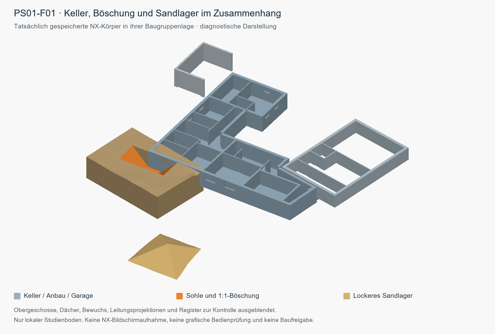

# K02 – unabhängige Böschungs- und Abraumstudie

Stand 01.11.2026. **Native Lieferung: PASS** für BASE und alle 22 Kandidaten (689 Parts). Echte Erzeugung, frisches AsSaved-Öffnen und verschobenes SearchDirectories-Öffnen sind pro Zustand belegt. **Grafische NX-Sichtprüfung weiterhin offen; keine Bauausführungsfreigabe.**

Lieferung: [`cad/nx/k02/20261101T133310_8b6d68/`](../../../cad/nx/k02/20261101T133310_8b6d68/). Alle ungerundeten Werte, Quellenhashes, Körperkomponenten und Warnungen stehen in [K02_MENGEN.json](K02_MENGEN.json); native Dateien und Messungen in BUILD/VERIFY. Öffnen nach Checkout: [NX-Anleitung](../../../cad/nx/README.md).

**Direkt öffnen:** [Renovierungsbasis BASE](../../../cad/nx/k02/20261101T133310_8b6d68/BASE/BASE_21.prt). Die Feldnamen in der Mengentabelle verlinken jeweils den eigenen tatsächlich gelieferten NX-Master. Den zugehörigen kompletten Zustandsordner mit allen Komponenten beibehalten.

## Aussageumfang

Alle 13 PS und 72 Registerfelder bleiben erhalten: 22 native Einzelfeldvarianten, 5 vollständige hypothetische Konfliktfelder und 45 ungeklärte/vorläufig ausgenommene Felder ohne Mengen. Jeder Zustand enthält höchstens ein offenes Feld. BASE und jedes Feld besitzen eigene gespeicherte Quellklone ohne bearbeitbare Original- oder Querverweise.

Die 60 positiven Projektionsüberschneidungen sind in der JSON einzeln ausgewiesen; sie sind keine berechneten gemeinsamen Aushubvolumen. Kumulative Union, erneut ausgehobene Verfüllung und Netto-Erstaushub sind nicht berechnet (JSON: null, nicht 0). Keine Feldsumme ist eine Netto-Baumenge oder ausführbare Reihenfolge.

## Annahmen und Mengenbasis

Maße in mm: Arbeitsraum 800, Sohlenlänge höchstens 2000, Seiten- und Endböschung 1:1 (45°), Hauptkeller-Prüfziel −2605. Die bestätigten Abmessungen und der angenommene Böschungsansatz belegen keine Standsicherheit. Beim Anbau fehlt die Bodenplatten-UK; dafür wird keine Sohle oder Menge erfunden. Der Höhenversatz -31362.49870845903 mm wird einmal angewendet. Die Quellhöhen bleiben unverändert; Hausbezug ist EG ±0,00.

Das lokale TIN approximiert das bilineare DGM mit 4 Unterteilungen; maximale vertikale Modellabweichung 20.78125 mm (Ziel höchstens 25 mm). Die Volumenintervalle beziehen sich auf dieses Höhenfehlerband, nicht auf Vermessungs- oder Baugrundunsicherheit. Der geschlossene Studienboden hat einen künstlichen unteren Abschluss. Originalgelände bleibt als geblankte Referenzkopie erhalten.

Bank bezeichnet das in der unabhängigen Variante erstmalig als gewachsen angesetzte TIN-Volumen. Locker = Bank × 1.05, verfügbar verdichtet = Bank × 0.89. Für das transparente Szenario „gesamten Hohlraum verfüllen, unbekannte Dämmverdrängung nicht abgezogen“ gilt Sollfüllung = Bank; benötigt locker = Sollfüllung × 1.05 / 0.89. Eine Differenz ist Bank-Volumenäquivalent, keine Masse. Wiederverdichtung kann Fehlmenge erzeugen; es entsteht hier kein automatisch verfügbarer Überschuss.

Die Faktoren stammen aus dem Sand-Beispiel der [WSDOT M46-03.08, Chapter 10, Table 10-1, S.10-12 (10/2013)](https://wsdot.wa.gov/publications/manuals/fulltext/m46-03/chapter10.pdf) gemäß [Studien-Spezifikation](../../../docs/plans/2026-11-01-nx-boeschung-studie-spec.md). Sie sind illustrative Volumenverhältnisse, keine örtlichen Kennwerte oder Trockenrohdichten. Locker 1.15/1.25 sind erhöhte Szenarien, keine belegte örtliche Bandbreite. Masse ist nicht bestimmt (JSON: null, nicht 0).

## Native Feldmengen

Alle Mengen m³, gerundet auf drei Nachkommastellen. V ist der mathematische TIN-Ansatz; NX ist der tatsächlich gemessene Aushub. Sollfüllung entspricht V. Wiederholter Aushub und Netto-Gesamtmenge sind nicht berechnet. † kennzeichnet eine weiterhin ungeklärte EG-Überbauprojektion am nativen Kandidaten.

Der native Komponentenvergleich verwendet max(10⁻¹⁰ m³, Erwartungsvolumen × 10⁻⁶); gespeicherte Summen müssen intern mit relativer Rundungstoleranz 10⁻¹² konsistent sein. Das prüft die CAD-Übertragung und unabhängiges Wiederöffnen, keine Geländepräzision. Die folgende NX−V-Differenz und das viel größere TIN-Volumenband sind getrennte Größen.

| Feld | V Bank / Füllsoll | NX Aushub | locker 1.05 | verdichtet 0.89 | Füllbedarf locker | Fehlbedarf Bankäquiv. |
| --- | --- | --- | --- | --- | --- | --- |
| [PS01-F01](../../../cad/nx/k02/20261101T133310_8b6d68/PS01-F01/PS01-F01_21.prt) | 20.255 | 20.255 | 21.268 | 18.027 | 23.896 | 2.503 |
| [PS01-F02](../../../cad/nx/k02/20261101T133310_8b6d68/PS01-F02/PS01-F02_21.prt) | 20.371 | 20.371 | 21.390 | 18.131 | 24.034 | 2.518 |
| [PS01-F03](../../../cad/nx/k02/20261101T133310_8b6d68/PS01-F03/PS01-F03_21.prt) | 19.601 | 19.601 | 20.581 | 17.445 | 23.125 | 2.423 |
| [PS01-F04](../../../cad/nx/k02/20261101T133310_8b6d68/PS01-F04/PS01-F04_21.prt) | 15.082 | 15.082 | 15.836 | 13.423 | 17.793 | 1.864 |
| [PS01-F05](../../../cad/nx/k02/20261101T133310_8b6d68/PS01-F05/PS01-F05_21.prt) | 9.040 | 9.040 | 9.492 | 8.046 | 10.665 | 1.117 |
| [PS01-F06](../../../cad/nx/k02/20261101T133310_8b6d68/PS01-F06/PS01-F06_21.prt) | 4.505 | 4.505 | 4.730 | 4.009 | 5.314 | 0.557 |
| [PS01-F07](../../../cad/nx/k02/20261101T133310_8b6d68/PS01-F07/PS01-F07_21.prt) | 10.474 | 10.474 | 10.997 | 9.322 | 12.357 | 1.295 |
| [PS01-F08](../../../cad/nx/k02/20261101T133310_8b6d68/PS01-F08/PS01-F08_21.prt) | 16.007 | 16.007 | 16.808 | 14.246 | 18.885 | 1.978 |
| [PS01-F09](../../../cad/nx/k02/20261101T133310_8b6d68/PS01-F09/PS01-F09_21.prt) | 19.721 | 19.721 | 20.707 | 17.551 | 23.266 | 2.437 |
| [PS01-F10](../../../cad/nx/k02/20261101T133310_8b6d68/PS01-F10/PS01-F10_21.prt) | 20.107 | 20.107 | 21.112 | 17.895 | 23.721 | 2.485 |
| [PS01-F11](../../../cad/nx/k02/20261101T133310_8b6d68/PS01-F11/PS01-F11_21.prt) | 20.682 | 20.682 | 21.716 | 18.407 | 24.400 | 2.556 |
| [PS04-F02](../../../cad/nx/k02/20261101T133310_8b6d68/PS04-F02/PS04-F02_21.prt)† | 25.073 | 25.073 | 26.327 | 22.315 | 29.581 | 3.099 |
| [PS06-F01](../../../cad/nx/k02/20261101T133310_8b6d68/PS06-F01/PS06-F01_21.prt)† | 24.543 | 24.543 | 25.770 | 21.843 | 28.955 | 3.033 |
| [PS06-F02](../../../cad/nx/k02/20261101T133310_8b6d68/PS06-F02/PS06-F02_21.prt)† | 24.612 | 24.612 | 25.842 | 21.904 | 29.036 | 3.042 |
| [PS06-F03](../../../cad/nx/k02/20261101T133310_8b6d68/PS06-F03/PS06-F03_21.prt)† | 24.148 | 24.148 | 25.355 | 21.492 | 28.489 | 2.985 |
| [PS07-F01](../../../cad/nx/k02/20261101T133310_8b6d68/PS07-F01/PS07-F01_21.prt)† | 23.070 | 23.070 | 24.224 | 20.533 | 27.218 | 2.851 |
| [PS07-F02](../../../cad/nx/k02/20261101T133310_8b6d68/PS07-F02/PS07-F02_21.prt)† | 23.258 | 23.258 | 24.421 | 20.700 | 27.439 | 2.875 |
| [PS09-F03](../../../cad/nx/k02/20261101T133310_8b6d68/PS09-F03/PS09-F03_21.prt) | 22.379 | 22.379 | 23.498 | 19.917 | 26.402 | 2.766 |
| [PS09-F04](../../../cad/nx/k02/20261101T133310_8b6d68/PS09-F04/PS09-F04_21.prt) | 21.840 | 21.840 | 22.932 | 19.438 | 25.767 | 2.699 |
| [PS09-F05](../../../cad/nx/k02/20261101T133310_8b6d68/PS09-F05/PS09-F05_21.prt) | 21.374 | 21.374 | 22.443 | 19.023 | 25.217 | 2.642 |
| [PS09-F06](../../../cad/nx/k02/20261101T133310_8b6d68/PS09-F06/PS09-F06_21.prt) | 20.874 | 20.874 | 21.918 | 18.578 | 24.627 | 2.580 |
| [PS09-F07](../../../cad/nx/k02/20261101T133310_8b6d68/PS09-F07/PS09-F07_21.prt) | 20.420 | 20.420 | 21.441 | 18.174 | 24.091 | 2.524 |

## Höhenband, Sensitivität und Lager

Lager 1:2 ist eine geschlossene geometrische Form mit Kontakt zum Studien-TIN; keine Standsicherheits- oder Logistikfreigabe. Hauptlager 1.05 und Reserve 1.25 stehen alternativ am gleichen Platz. Nur das Hauptlager ist standardmäßig sichtbar. Die projizierte Kontaktfläche stammt aus den disjunkten mathematischen TIN-Kontaktpolygonen und ist keine native Flächenmessung. Lagerlastabstände und Transportwege bleiben ungeprüft. Der Füllbedarf der erhöhten Lockerungsszenarien verwendet weiterhin verdichtet/Bank 0.89 und dasselbe volle Hohlraumszenario.

| Feld | V-Band m³ | locker 1.15 m³ | Reserve 1.25 m³ | Füllbedarf locker 1.15/1.25 m³ | Kontakt Haupt/Reserve m² | NX−V m³ |
| --- | --- | --- | --- | --- | --- | --- |
| PS01-F01 | 19.849–20.667 | 23.293 | 25.319 | 26.172/28.448 | 41.622/46.630 | 0.000000000 |
| PS01-F02 | 19.966–20.782 | 23.427 | 25.464 | 26.323/28.612 | 41.777/46.805 | -0.000000000 |
| PS01-F03 | 19.223–19.984 | 22.541 | 24.501 | 25.327/27.530 | 40.744/45.642 | -0.000000000 |
| PS01-F04 | 14.786–15.382 | 17.344 | 18.852 | 19.488/21.182 | 34.392/38.491 | 0.000000000 |
| PS01-F05 | 8.794–9.290 | 10.396 | 11.300 | 11.681/12.697 | 24.757/27.678 | -0.000000000 |
| PS01-F06 | 4.307–4.712 | 5.180 | 5.631 | 5.821/6.327 | 15.794/17.679 | -0.000000000 |
| PS01-F07 | 10.213–10.739 | 12.045 | 13.092 | 13.533/14.710 | 27.200/30.424 | -0.000000000 |
| PS01-F08 | 15.689–16.330 | 18.408 | 20.009 | 20.684/22.482 | 35.739/40.005 | 0.000000000 |
| PS01-F09 | 19.338–20.108 | 22.679 | 24.651 | 25.482/27.698 | 40.905/45.823 | -0.000000000 |
| PS01-F10 | 19.697–20.522 | 23.123 | 25.133 | 25.980/28.240 | 41.423/46.406 | 0.000000000 |
| PS01-F11 | 20.264–21.106 | 23.785 | 25.853 | 26.724/29.048 | 42.190/47.270 | 0.000000000 |
| PS04-F02 | 24.609–25.544 | 28.834 | 31.342 | 32.398/35.215 | 47.834/53.631 | 0.000000000 |
| PS06-F01 | 24.081–25.009 | 28.224 | 30.678 | 31.712/34.470 | 47.171/52.881 | 0.000000000 |
| PS06-F02 | 24.149–25.080 | 28.303 | 30.765 | 31.802/34.567 | 47.257/52.979 | 0.000000000 |
| PS06-F03 | 23.698–24.603 | 27.770 | 30.185 | 31.202/33.915 | 46.674/52.320 | -0.000000000 |
| PS07-F01 | 22.624–23.523 | 26.531 | 28.838 | 29.810/32.402 | 45.304/50.773 | 0.000000000 |
| PS07-F02 | 22.794–23.729 | 26.747 | 29.073 | 30.052/32.666 | 45.544/51.044 | -0.000000000 |
| PS09-F03 | 21.946–22.817 | 25.736 | 27.974 | 28.917/31.431 | 44.413/49.768 | 0.000000000 |
| PS09-F04 | 21.414–22.273 | 25.116 | 27.300 | 28.221/30.675 | 43.714/48.980 | 0.000000000 |
| PS09-F05 | 20.954–21.800 | 24.580 | 26.718 | 27.618/30.020 | 43.104/48.296 | -0.000000000 |
| PS09-F06 | 20.459–21.296 | 24.006 | 26.093 | 26.973/29.318 | 42.445/47.556 | -0.000000000 |
| PS09-F07 | 20.011–20.834 | 23.483 | 25.525 | 26.385/28.680 | 41.842/46.878 | 0.000000000 |

Lagerzentren je Feld, Apexhöhen, native Haupt-/Reservevolumen, deren Höhenfehlerintervalle und alle Platzierungsversuche stehen in der JSON. Die Platzprüfung berücksichtigt Kartenfläche, bekannte Hindernisse, Eingriffsprojektion und angenommene Medienkorridore. Sie bestätigt keine tatsächliche Grenze, Leitungstiefe, Lastverträglichkeit oder Zugänglichkeit.

## Konflikte und ungeklärte Restbereiche

Bei geometrischen Konflikten bleibt das vollständige hypothetische Feld erhalten; es wird nicht passend beschnitten und nicht nativ geliefert. Die folgenden V-Werte sind Konfliktdiagnosen. Zugehörige Material-/Sensitivitätswerte sind ebenfalls nur hypothetisch und stehen ausdrücklich so gekennzeichnet in der JSON.

| Feld | hypothetisches V m³ | Konflikt |
| --- | --- | --- |
| PS04-F01 | 25.045 | OBSTACLE:ANBAU_KG |
| PS07-F03 | 24.422 | OBSTACLE:GARAGE |
| PS07-F04 | 25.396 | OBSTACLE:GARAGE |
| PS09-F01 | 22.910 | OBSTACLE:GARAGE |
| PS09-F02 | 22.776 | OBSTACLE:GARAGE |

Ungeklärte/ausgenommene Felder haben null für Volumen, Material, native Messung und Haufengeometrie. Null bedeutet unbekannt/nicht modelliert, niemals 0 m³. MASK_BOUNDARY_UNKNOWN = Ausnahmemaske noch nicht abgegrenzt; INTERFACE_UNRESOLVED = Anschluss ungeklärt; UNKNOWN_FORMATION = Sohle/Bodenplatten-UK unbekannt. PS02-Niedergang wird nicht pauschal als gesamte Fassade ausgeschlossen.

| PS | Felder ohne native Variante | nominale Sohlenlinien m | Gründe |
| --- | --- | --- | --- |
| PS02 | PS02-F01, PS02-F02, PS02-F03 | 4.862 | MASK_BOUNDARY_UNKNOWN |
| PS03 | PS03-F01, PS03-F02, PS03-F03, PS03-F04, PS03-F05, PS03-F06 | 8.150 | INTERFACE_UNRESOLVED |
| PS04 | PS04-F01 | 1.917 | OBSTACLE:ANBAU_KG |
| PS05 | PS05-F01, PS05-F02, PS05-F03, PS05-F04, PS05-F05, PS05-F06, PS05-F07, PS05-F08 | 13.305 | MASK_BOUNDARY_UNKNOWN |
| PS07 | PS07-F03, PS07-F04 | 3.965 | OBSTACLE:GARAGE |
| PS08 | PS08-F01, PS08-F02, PS08-F03, PS08-F04 | 6.430 | MASK_BOUNDARY_UNKNOWN |
| PS09 | PS09-F01, PS09-F02 | 3.571 | OBSTACLE:GARAGE |
| PS10 | PS10-F01, PS10-F02, PS10-F03, PS10-F04, PS10-F05 | 8.730 | INTERFACE_UNRESOLVED, UNKNOWN_FORMATION |
| PS11 | PS11-F01, PS11-F02, PS11-F03, PS11-F04, PS11-F05, PS11-F06, PS11-F07 | 13.230 | UNKNOWN_FORMATION |
| PS12 | PS12-F01, PS12-F02, PS12-F03, PS12-F04, PS12-F05 | 8.730 | UNKNOWN_FORMATION |
| PS13 | PS13-F01, PS13-F02, PS13-F03, PS13-F04, PS13-F05, PS13-F06, PS13-F07 | 13.230 | UNKNOWN_FORMATION |

Die nominalen Längen beschreiben ausschließlich Register-Sohlenlinien. Sie sind kein Nachweis der sanierten oder unerreichbaren Wand-/Abdichtungsfläche: Endböschungen, Ecken, Überlappungen und ungeklärte Ausnahmemasken verhindern eine solche Flächenbilanz. Eine bereinigte verbleibende Gesamtfläche ist nicht berechnet.

Zusätzlich tragen 6 native Kandidaten ungeklärte EG-Überbauprojektionen: PS04-F02, PS06-F01, PS06-F02, PS06-F03, PS07-F01, PS07-F02. Diese Warnung bleibt trotz bestandenem Nativlauf bestehen. Alle weiteren Leitungsprojektionstreffer sind je Feld in der JSON erhalten; angenommene Korridorbreite ist kein Sicherheitsabstand.

PS01-F06 behält sämtliche getrennten geschlossenen Aushubkomponenten; Einzelvolumen und Summe stehen in den nativen Messrecords. Das Gelände-Boolean entfernt ihre gemeinsame Materialmenge; weder kleine Komponenten noch Konfliktwarnungen werden verworfen. Die getrennte Geometrie bleibt als Feldinterpretation ungeklärt und ist kein nachgewiesener durchgehender Arbeitsgraben. Ist sie für die Planung ungeeignet, müssen die Feldgrenzen überarbeitet werden.

## Offene Prüfung und Bedienung

Repräsentatives Feld PS01-F01: tatsächlicher NX-Occurrence-STL-Export der final gespeicherten Körper in Baugruppenlage, anschließend mit diagnostischen Farben gerendert. Keller, Anbau, Garage, Schnittboden und Hauptlager sind enthalten; Obergeschosse, Dächer, Bewuchs, Leitungsprojektionen und Register sind für die Kontrolle ausgeblendet. Unter dem Lager ist kein zusätzlicher Gelände-Patch eingeblendet; seine geschlossene Kontaktunterseite folgt dem Studien-TIN. [Bildherkunft und Quellhashes](../../../docs/entwicklungsstand/K02_PS01-F01_KONTEXT.json). Die Ansicht erlaubt eine Geometriesichtkontrolle dieses einen Feldes, keine Aussage zur grafischen Bedienung oder allen 22 Zuständen. Roh-STL und temporäre Exportskripte sind keine mitgelieferten Abhängigkeiten.

Die echte NX-Bildschirmaufnahme und Prüfung von Schnittsichtbarkeit, Böschungsdarstellung, Platzierung und ausgeschlossenen Bereichen ist weiterhin offen, weil der grafische Zugriff keinen verwertbaren Capture lieferte. Gespeicherte Layer-/Blankflags und echte native Messungen sind Batch-Belege; eine externe Diagnoseansicht aus NX-STL wäre ebenfalls kein NX-Screenshot oder Kameranachweis.

Öffnen und Rollenschaltung beschreibt die [NX-Anleitung](../../../cad/nx/README.md). Originalteile und andere Zustände nicht als Komponenten hinzufügen. Die Studienbasis ersetzt keine Nutzerbearbeitungen in früheren Modellen. Gründung, Boden, Wasser, Leitungen, Lasten, Zugang und Abdichtungsdetails müssen fachlich geklärt werden. Die Nutzererwartung „kein Grundwasserproblem auf Kellertiefe“ bleibt eine Angabe ohne Mess- oder Bemessungskote. Sämtliche Felder haben construction_release=false.
